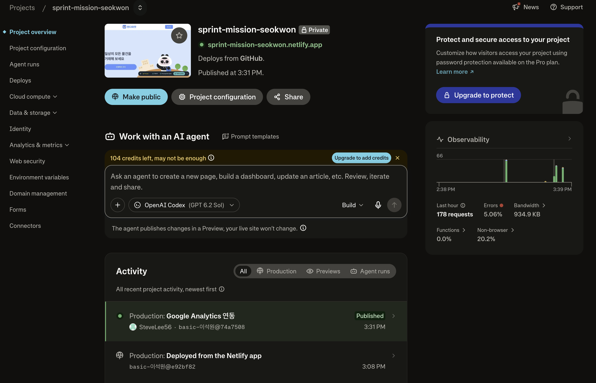
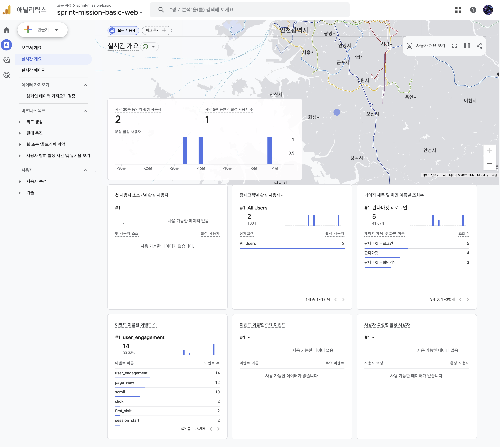

# 🐼 판다마켓 (Panda Market)

https://sprint-mission-seokwon.netlify.app/

# 목차

- [스프린트 미션1](#스프린트-미션-1---디자인-및-구현-요구사항)
- [스프린트 미션2](#스프린트-미션-2---로그인-및-회원가입-페이지-구현)
   
   
   

# 스프린트 미션 1 - 디자인 및 구현 요구사항

 

## 1. 기본 요구사항

### 1-1. 랜딩 페이지 구현

- [x] React와 같은 UI 라이브러리를 사용하지 않고 구현합니다.
- [x] PC 사이즈만 고려하여 제공된 디자인을 구현합니다.
- [x] HTML, CSS 파일을 [Netlify](https://www.netlify.com/)를 통해 배포합니다.
  - 참고 자료: [Netlify 배포 가이드](https://www.codeit.kr/learn/5309)
- [x] 랜딩 페이지의 URL Path는 루트(`/`)로 설정합니다.
- [x] 페이지의 `title`은 **판다마켓**으로 설정합니다.

### 1-2. 페이지 이동 기능

- [x] **판다마켓** 로고 클릭 시 루트 페이지(`/`)로 이동합니다.
- [x] **로그인** 버튼 클릭 시 로그인 페이지(`/login`)로 이동합니다. (빈 페이지)
- [x] **구경하러 가기** 버튼 클릭 시 상품 목록 페이지(`/items`)로 이동합니다. (빈 페이지)
- [x] **Privacy Policy** 클릭 시 Privacy 페이지(`/privacy`)로 이동합니다. (빈 페이지)
- [x] **FAQ** 클릭 시 FAQ 페이지(`/faq`)로 이동합니다. (빈 페이지)
- [x] 페이스북, 트위터, 유튜브, 인스타그램 아이콘 클릭 시 각각의 공식 홈페이지로 새 창에서 이동합니다.

### 1-3. 상단 내비게이션 바 (Global Navigation Bar)

- [x] 페이지를 아래로 스크롤하더라도 상단 내비게이션 바가 최상단에 고정되어야 합니다.
- [x] 상단 내비게이션 바에는 **판다마켓 로고**와 **로그인 버튼**이 포함되어야 합니다.

### 1-4. 반응형 레이아웃 및 정렬

#### 화면 너비 1920px 이상

- [x] 하늘색 배경은 화면 너비 전체를 채워야 합니다.
- [x] 내부 요소들의 위치는 고정하고 바깥쪽 여백만 증가하도록 설정합니다.
- [x] 내부 요소 간 동일한 간격을 유지하며 가운데 정렬합니다.

#### 화면 너비 1920px 미만

- [x] 판다마켓 로고의 왼쪽 여백은 200px을 유지합니다.
- [x] 로그인 버튼의 오른쪽 여백은 200px을 유지합니다.
- [x] 화면 너비가 줄어들수록 로고와 로그인 버튼 사이의 거리가 가까워지도록 설정합니다.

#### 하단 푸터 레이아웃

- [x] 화면 너비 1920px 이상에서는 내부 요소 간 동일한 간격을 유지하며 가운데 정렬합니다.
- [x] 화면 너비 1920px 미만에서는 `codeit-2024`의 왼쪽 여백 200px을 유지합니다.
- [x] SNS 아이콘들의 오른쪽 여백은 200px을 유지합니다.
- [x] 가운데에 배치된 `Privacy Policy`와 `FAQ` 요소는 각각 동일한 간격을 유지하면서 화면 너비가 줄어들수록 가까워지도록 설정합니다.

### 1-5. 사용자 인터랙션

- [x] 클릭으로 기능이 동작하는 요소는 사용자가 클릭 가능한 요소임을 알 수 있도록 CSS의 `cursor: pointer` 속성을 적용합니다.

---

## 2. 심화 요구사항

### 2-1. 공통 스타일 설정

- [x] `reset.css` 파일을 설정하여 브라우저별 기본 스타일 차이를 초기화합니다.
- [x] 사용자의 브라우저 기본 폰트 크기 설정에 따라 페이지의 크기 관련 값이 함께 변화하도록 구현합니다.
  - 요소 간 간격
  - 요소의 너비와 높이
  - 폰트 크기 (`font-size`)
  - 기타 크기와 관련된 모든 CSS 속성

### 2-2. 상대 단위 활용

- [x] 브라우저의 기본 폰트 크기 설정을 기준으로 페이지 전체의 크기가 확대 및 축소될 수 있도록 상대 단위를 활용합니다.
- [x] `px` 대신 `rem` 등의 상대 단위를 적절히 사용합니다.

---

## 3. 최종 체크리스트

- [x] Figma 디자인과 구현 결과 비교
- [x] HTML 및 CSS 기반으로 구현했는지 확인
- [x] 페이지 제목 및 경로 설정 확인
- [x] 로고 및 버튼 페이지 이동 확인
- [x] SNS 링크 새 창 열기 확인
- [x] 상단 내비게이션 바 고정 확인
- [x] 1920px 기준 레이아웃 확인
- [x] 푸터 요소 정렬 및 간격 확인
- [x] 클릭 가능한 요소에 `cursor: pointer` 적용
- [x] `reset.css` 적용 확인
- [x] `rem` 등 상대 단위 적용 확인
- [x] Netlify 배포 및 접속 확인

 
 
 
 
 
 

# 스프린트 미션 2 - 로그인 및 회원가입 페이지 구현

## 1. 기본 요구사항

### 1-1. 공통 사항

- [x] `README.md` 파일을 작성합니다.
  - [x] Markdown 문법을 숙지하여 작성합니다.
  - [x] README 내용은 자유롭게 작성합니다.
- [x] 본인의 브랜치에 스프린트 미션을 업로드합니다.
  - 브랜치명 예시: `part1-홍길동`
- [x] 적절한 커밋 메시지를 작성합니다.
- [x] `1-Sprint-Mission` 레포지토리를 Fork 합니다.
- [ ] GitHub에서 PR(Pull Request)을 생성하여 upstream의 본인 브랜치에 미션을 제출합니다.
- [x] PR 코멘트에 다음 내용을 포함합니다.
- [x] 스프린트 미션 요구사항 체크리스트
  - [x] 아래 참고 이미지와 같이 완료한 항목에 체크 표시를 합니다.
  - [x] 주요 변경사항
  - [x] 멘토님에게 남길 메시지
- [x] Git 활용 과정에서 Unix 명령어를 활용합니다.
- [x] HTML, CSS 파일을 Netlify를 통해 배포합니다.
  - 참고 자료: [Netlify 배포 가이드](https://www.codeit.kr/learn/5309)

    

### 1-2. 로그인 페이지 및 회원가입 페이지 공통

- [x] **판다마켓 로고** 클릭 시 루트 페이지(`/`)로 이동합니다.
- [x] SNS 아이콘 클릭 시 지정된 홈페이지로 이동합니다.
  - Google: https://www.google.com/
  - Kakao: https://www.kakaocorp.com/page/
- [x] Input 요소에 포커스(Focus In)가 적용되면 테두리 색상을 `#3692FF`로 설정합니다.
- [x] Input 요소에서 포커스가 해제(Focus Out)되면 테두리를 제거합니다.

### 1-3. 로그인 페이지

- [x] **회원가입** 버튼 클릭 시 회원가입 페이지(`/signup`)로 이동합니다.

### 1-4. 회원가입 페이지

- [x] **로그인** 버튼 클릭 시 로그인 페이지(`/login`)로 이동합니다.

---

## 2. 심화 요구사항

### 2-1. 공통 사항

- [x] 디자인 시스템의 Palette에 정의된 색상값을 CSS 변수로 등록하여 사용합니다.
- [x] Google Analytics를 연동하여 웹사이트 방문자 수를 확인할 수 있도록 설정합니다.

  

### 2-2. 로그인 페이지 및 회원가입 페이지 공통

- [x] 비밀번호 Input 요소 오른쪽에 비밀번호 표시 여부를 제어할 수 있는 눈 모양 아이콘을 추가합니다.
- [x] 비밀번호 확인 Input 요소 오른쪽에도 비밀번호 표시 여부를 제어할 수 있는 눈 모양 아이콘을 추가합니다.

---

## 3. 최종 체크리스트

### 프로젝트 및 Git 관리

- [x] README.md 작성
- [x] 레포지토리 Fork
- [x] 본인 브랜치 생성 및 작업물 업로드
- [x] 적절한 커밋 메시지 작성
- [x] Unix
